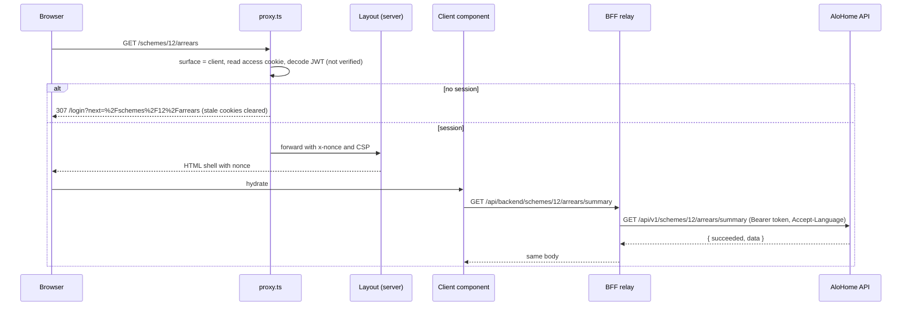

# AloHome Front: Architecture

This document describes how the web frontend is built and why. For a tour of every screen and module, see [system-overview.md](system-overview.md). For end-user instructions, see [usage-guide.md](usage-guide.md). Individual decisions are recorded in [`adr/`](adr).

## 1. Context

AloHome helps strata schemes in New South Wales and residential buildings in Iran understand their finances. It shows fund balances, arrears, spending, unusual expenses, capital works funding and monthly reports. The frontend is one Next.js application in front of the AloHome .NET API (`../AloHome`).

```mermaid
flowchart LR
  subgraph Browser
    C[Client UI<br/>/login, /schemes]
    B[Back-office UI<br/>/backoffice]
  end
  subgraph Next.js["Next.js server (this app)"]
    P[proxy.ts<br/>route gating + CSP]
    A1[/api/auth/*]
    R1[/api/backend/*]
    A2[/api/bo/auth/*]
    R2[/api/bo/backend/*]
    T[/api/telemetry]
    H[/api/health]
  end
  API[(AloHome API<br/>/api/v1)]
  LOG[(Log pipeline)]

  C --> P
  B --> P
  C --> A1 & R1 & T
  B --> A2 & R2 & T
  A1 & R1 & A2 & R2 --> API
  T --> LOG
```

The browser never talks to the API directly. Every call goes through the app's own route handlers, which form a backend-for-frontend (BFF).

## 2. Guiding constraints

| Constraint                                                 | Consequence in the design                                                                                                                      |
| ---------------------------------------------------------- | ---------------------------------------------------------------------------------------------------------------------------------------------- |
| The API is the authority for data and permissions          | The UI hides what a role cannot do, but every rule is enforced again by the API. Client-side validation is a UX aid only.                      |
| Tokens must not be readable by page scripts                | Tokens live in `HttpOnly` cookies set by the BFF. Client code never sees them.                                                                 |
| Staff tools carry higher risk than resident tools          | Back office is a separate surface with its own login, cookies and relay allowlist ([ADR 0003](adr/0003-two-surfaces.md)).                      |
| Two markets with different money, calendars and vocabulary | Region is a first-class concept, separate from language ([ADR 0004](adr/0004-region-vs-locale.md)).                                            |
| Every page depends on the signed-in user                   | All routes render dynamically. No shared caching ([ADR 0002](adr/0002-cache-components-disabled.md)).                                          |
| AI output can be wrong                                     | AI content is labelled, styled apart, shows confidence and evidence, and always offers feedback. Figures come from deterministic calculations. |

## 3. Technology

| Concern              | Choice                                                                                                                                     |
| -------------------- | ------------------------------------------------------------------------------------------------------------------------------------------ |
| Framework            | Next.js 16 App Router, React 19, Turbopack, `output: "standalone"`                                                                         |
| Language             | TypeScript, strict mode                                                                                                                    |
| Styling              | Tailwind CSS 4 with CSS-variable design tokens, Vazirmatn font, RTL and LTR                                                                |
| Server state         | TanStack Query (`staleTime` 30 s, retries only for network and 5xx errors, no mutation retries)                                            |
| Forms and validation | Raw string state parsed with zod on submit, react-hook-form where it helps                                                                 |
| Charts               | Small in-house SVG and HTML components with a table fallback. No chart library.                                                            |
| Tests                | Vitest and Testing Library for units, Playwright against `mock-api/` for end-to-end                                                        |
| Delivery             | Multi-stage Docker image, non-root user, health check on `/api/health`. CI: format, typecheck, lint, unit tests, build, e2e, Docker build. |

## 4. Two surfaces

The app serves two products from one deployment. `src/lib/bff/surface.ts` is the single place that maps a surface to its paths and cookies.

|                 | Client                                                            | Back office                                                                                                   |
| --------------- | ----------------------------------------------------------------- | ------------------------------------------------------------------------------------------------------------- |
| Users           | Strata or building managers, committee members, owners, residents | AloHome staff with the `Admin` role                                                                           |
| Pages           | `/login`, `/register`, `/schemes/...`                             | `/backoffice/login`, `/backoffice/forbidden`, `/backoffice/...`                                               |
| Auth routes     | `/api/auth/{request-otp,register,login,logout,session}`           | `/api/bo/auth/{request-otp,login,logout,session}` (no self-registration)                                      |
| Relay           | `/api/backend/*`                                                  | `/api/bo/backend/*`                                                                                           |
| Relay allowlist | `schemes/...`, `product/...`, `organisations/...`, `portfolio`    | `backoffice/schemes`, `users`, `pilot`, `demo`, `organisations`, `audit-logs`, `evidence`, `pilot-agreements` |
| Cookies         | `alohomeAccessToken`, `alohomeRefreshToken`                       | `alohomeBoAccessToken`, `alohomeBoRefreshToken`                                                               |
| Shell           | `ClientShell` plus the per-scheme navigation                      | `BackofficeShell`                                                                                             |
| Extra headers   | None                                                              | `Cache-Control: no-store`, `X-Robots-Tag: noindex, nofollow`                                                  |

Properties that follow from this split:

- A client token cannot address back-office API routes, because the client relay does not allow them.
- A back-office sign-in never creates a client session, and the other way round. A staff member can hold both in one browser.
- A back-office login by an account without `Admin` is refused before any cookie is set. The upstream session that the login just created is revoked.
- A 401 from the API clears only the cookies of the surface that made the call.

Legacy URLs are redirected in `next.config.ts`: `/admin/*` goes to `/backoffice/*` and `/dashboard/*` goes to `/schemes`.

## 5. Request flow

### 5.1 Page request



`proxy.ts` does the following:

- It runs on every page request except `api`, static files and prefetches.
- It works out the surface from the path and reads that surface's access cookie.
- It decodes the JWT without verifying it. The decoded token is used only to decide where to route the request.
- It applies these rules:
  - Client: `/schemes/*` requires a session, and a signed-in user who opens `/login` or `/register` goes to `/schemes`.
  - Back office: every path except `/backoffice/login` requires a session. A session without `Admin` goes to `/backoffice/forbidden`. A signed-in admin who opens the login page goes to `/backoffice`.
  - The `next` parameter is cleaned by `safeNextPath`, so it can only point inside the same surface.
- It generates a per-request nonce and sets the Content-Security-Policy.

The back-office console layout also calls `requireBackoffice()` on the server, so a page never renders for a non-admin even if the proxy is bypassed.

### 5.2 Relay

`src/lib/bff/relay.ts` is a narrow, authenticated pass-through. The client relay and the back-office relay share it.

The relay applies these checks:

- **Origin:** every mutating request must carry a same-origin `Origin` header (`assertSameOrigin`). `ALLOWED_ORIGINS` can widen this.
- **Path:** at most 10 segments. Each segment must match `[A-Za-z0-9-]{1,64}` and is lower-cased. The path must start with one of the surface's allowed roots.
- **Size:** a JSON body is limited to 64 KB, and the query string to 1,024 characters.
- **Uploads:** multipart bodies are accepted only on `schemes/{id}/imports` and `schemes/{id}/imports/{guid}/retry`, and are capped by `MAX_UPLOAD_BYTES` (20 MB by default).
- **Timeouts:** `BACKEND_TIMEOUT_MS` for ordinary calls, and `UPLOAD_TIMEOUT_MS` for uploads and PDF downloads.
- **Forwarded to the API:** the Bearer token from the surface cookie, the user's language as `Accept-Language`, and the correlation id.
- **Redirects** are not followed.
- **On a 401**, the surface's cookies are cleared.

### 5.3 Sign-in

Sign-in uses a one-time code sent by SMS.

1. The browser calls `/api/auth/request-otp` (or the `/api/bo/...` route) with a phone number in E.164 form.
2. The browser calls `/api/auth/login` with the phone number and the 6-digit code.
3. The BFF calls `authentication/login` on the API. It reads the access and refresh tokens from the API's `Set-Cookie` headers and stores them under the surface's own cookie names: `HttpOnly`, `SameSite=Lax`, and `Secure` in production.
4. For the back office, the BFF checks the `Admin` role before setting any cookie.

Sign-out calls `authentication/logout` with the refresh token and clears the surface's cookies.

## 6. Source layout

```
src/
  app/                         routes only; thin pages that compose features
    (auth)/                    client login and register
    (client)/schemes/          scheme picker and the scheme workspace
      [schemeId]/              layout loads scheme context; one folder per area
    backoffice/(public)/       staff login, forbidden
    backoffice/(console)/      staff console (requireBackoffice in layout)
    api/                       BFF route handlers, telemetry, health
  features/
    client/<area>/             screens and their logic per business area
    backoffice/<area>/
  components/
    ui/                        buttons, fields, tables, dialogs, toasts, state views
    layout/                    shells, locale/region/currency switchers, sign-out
    finance/                   money, stat tiles, freshness, enum badges
    charts/                    SVG series and bar charts with table fallback
    forms/                     date and money inputs (calendar and currency aware)
    ai/                        insight panel, confidence, feedback widget
  lib/
    api/                       typed client, finance and back-office endpoints, envelope, errors, query keys
    bff/                       server-only: surface, cookies, relay, path allowlist, guards
    auth/                      JWT decoding, session helpers, safe redirects
    region/                    region profiles, Gregorian and Jalali dates
    format/                    money, number and date formatting
    telemetry/                 event allowlist and client
    query/                     generic mutation hook
    validation/                zod schemas for auth forms
  i18n/                        dictionaries (composed from sections), translator, terminology, provider
  proxy.ts                     route gating and CSP
```

Rules that keep this layout healthy:

- `app/` files stay thin. They read params, call `requireSession` or `requireBackoffice` where needed, and render a feature component.
- A feature does not import from another feature. Shared pieces move to `components/` or `lib/`.
- `server-only` marks every module that touches environment variables or tokens, so it cannot leak into a client bundle.

## 7. API layer

`src/lib/api` is the only code that knows the API's wire format.

- **Endpoints:** `finance/endpoints.ts` groups the calls by area: schemes, imports, financial records, expenses, flags, arrears, capital works, AI, health and reports, and feedback. `backoffice.ts` does the same for staff endpoints.
- **Envelope:** `unwrap` accepts both `{ succeeded, data }` and a bare body. `asPage` and `asList` accept both a bare array and a paginated result, so a gateway change does not break screens.
- **Enums:** the API takes numbers in requests and returns strings in results. `finance/enums.ts` maps both ways, and unknown values fall back to the raw string.
- **Errors:** `ApiError` carries the status, code, localised details and correlation id. `describeError` turns one into a user message. Only network failures and 5xx responses count as retryable.
- **Query keys:** `keys.ts` builds them hierarchically per scheme, so a mutation can invalidate exactly what it changed.
- **Mutations** go through `useApiMutation`, which handles success toasts, error messages and invalidation in one place. `useSchemeMutation` and `useBoMutation` are thin aliases of it.

## 8. Internationalisation and regions

There are two independent settings.

| Setting | Values     | Decides                                                            | Stored in                                                                     |
| ------- | ---------- | ------------------------------------------------------------------ | ----------------------------------------------------------------------------- |
| Locale  | `fa`, `en` | Text, direction (RTL or LTR), digits                               | `alohome-locale` cookie                                                       |
| Region  | `ir`, `au` | Currency, calendar, time zone, phone and postal rules, terminology | `alohome-region` cookie outside a scheme; the scheme's jurisdiction inside it |

| Region | Currency                                             | Calendar  | Time zone        | Phone | Postal code | Week starts |
| ------ | ---------------------------------------------------- | --------- | ---------------- | ----- | ----------- | ----------- |
| `ir`   | IRR (Toman as display unit, `alohome-currency-unit`) | Jalali    | Asia/Tehran      | +98   | 10 digits   | Saturday    |
| `au`   | AUD                                                  | Gregorian | Australia/Sydney | +61   | 4 digits    | Monday      |

- **Scheme region:** the scheme layout wraps its pages in a nested `I18nProvider` whose region comes from the scheme's `jurisdictionCode` (`IR` or `AU-NSW`). A manager with schemes in both markets sees each in its own format.
- **Dictionaries:** `en.ts` and `fa.ts` are built from section files under `dictionaries/sections/`. `MessageKey` is derived from the English dictionary, and the Persian one must match it.
- **Terminology:** strings use placeholders such as `{scheme}`, `{Lots}` and `{arrears}`. `terms.ts` resolves them for each region and language. In Australian English a `{lot}` is a "lot"; in Iranian English it is a "unit"; in Iranian Persian it is "واحد". A capital first letter in a placeholder capitalises the term. A test checks that both languages use the same placeholders.
- **Formatting:** all money, numbers, dates, periods and fiscal years go through `fmt` from `useI18n()`. Formatting a value by hand anywhere else is a bug.

## 9. AI content

Explanations and category suggestions come from the API's AI endpoints. The UI treats them differently from deterministic figures:

- A distinct visual tone and an "AI-generated" label.
- A confidence indicator. A 0–1 scale is assumed, and 0–100 is accepted.
- Evidence references, shown as record IDs.
- A status for each outcome: Generated, Unavailable, Rejected or InsufficientEvidence. Only Generated shows text.
- A review action (Useful, Incorrect, Needs review) and a feedback widget.

No figure on a dashboard or in a report comes only from AI.

## 10. Telemetry

`/api/telemetry` accepts product events from either surface.

- It requires the same-origin check and an active session.
- Event names come from a fixed list in `lib/telemetry/events.ts`.
- Property names are allowlisted. Values must be short identifiers matching `[A-Za-z0-9_.:-]{1,40}`, or bounded integers. Free text, amounts, names and phone numbers are rejected by the schema.
- It logs one structured JSON line per event, with a short SHA-256 hash of the user id in place of the id.
- It is rate-limited to 120 events per user per minute. The limiter is in memory and per instance.

The log pipeline is expected to forward these lines to analytics. No vendor SDK runs in the browser.

## 11. Security summary

| Threat                              | Control                                                                                                                        |
| ----------------------------------- | ------------------------------------------------------------------------------------------------------------------------------ |
| XSS                                 | Nonce-based CSP with `strict-dynamic`, no `unsafe-eval` in production, `object-src 'none'`. React escaping.                    |
| Token theft by script               | `HttpOnly` cookies. Tokens never reach client JavaScript.                                                                      |
| CSRF                                | `SameSite=Lax` cookies plus an `Origin` check on every mutating BFF call.                                                      |
| Clickjacking                        | `frame-ancestors 'none'` and `X-Frame-Options: DENY`.                                                                          |
| Open proxy or SSRF through the BFF  | Per-surface path allowlist, segment validation, no redirect following, fixed upstream base URL.                                |
| Privilege escalation to staff tools | Separate cookies and relay. Admin check in the proxy, in the console layout and at login. The API enforces it again.           |
| Open redirect                       | `safeNextPath` limits `next` to same-surface relative paths.                                                                   |
| CSV formula injection               | Exported cells that start with `=`, `+`, `-`, `@`, a tab or a carriage return are prefixed so spreadsheets treat them as text. |
| Oversized requests                  | Body, query and upload caps in the relay.                                                                                      |
| Transport                           | HSTS, `Secure` cookies in production.                                                                                          |

## 12. Quality and delivery

- **Unit tests** cover the translator and placeholder parity, Jalali conversion, region dates, money formatting, chart scales, JWT decoding, safe redirects, `Set-Cookie` parsing, relay path rules, the origin guard, API errors, telemetry rules and the feature parsers.
- **End-to-end tests** (`e2e/app.spec.ts`) run against `mock-api/server.mjs`. They cover route protection on both surfaces, legacy redirects, CSP headers, the origin check, client sign-in and scheme selection, back-office admin and non-admin sign-in, isolation between the two sessions, and that every client page (for both markets) and every back-office page renders without an error.
- **CI** (`.github/workflows/ci.yml`) has three jobs: verify (format check, typecheck, lint, unit tests, build), e2e, and a Docker build.

## 13. Known limits and open questions

- The e2e suite uses a mock API. It checks frontend behaviour, not compatibility with the real API. A contract test against a running API is the next step.
- These response shapes are unverified against the real API: some list endpoints, `POST backoffice/users`, the feedback `subjectId` for risk signals, and the AI confidence scale.
- AI evidence is shown as record IDs because there is no endpoint to fetch records by id.
- There is no residents list endpoint, so the back office manages residents by user id.
- The telemetry rate limiter is per instance. Behind several replicas, the effective limit grows with the replica count.
